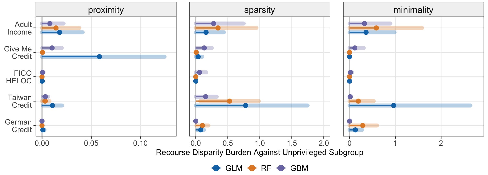
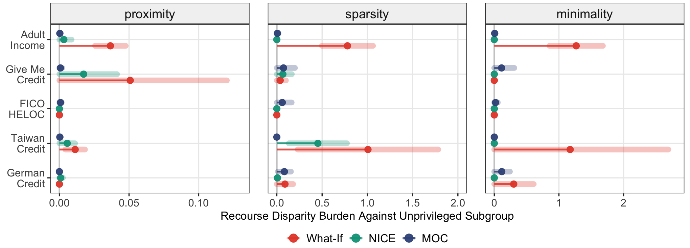
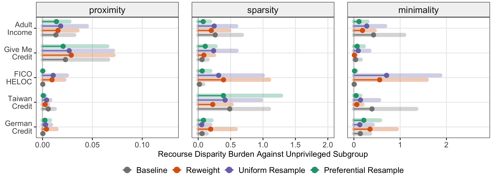

# Does Predictive Fairness Imply Recourse Fairness? An Empirical Study Across Model Classes and Search Paradigms

This repository contains the replication code, curated benchmark datasets, pre-trained predictive models, and experimental evaluation results for the empirical study auditing counterfactual recourse fairness across machine learning model classes, counterfactual search paradigms, and pre-processing algorithmic fairness interventions.

---

## Repository Structure

```
recourse-fairness/
├── data/                       # Curated benchmark datasets (train/test splits)
│   ├── adult_train.csv / adult_test.csv
│   ├── fico_heloc.csv
│   ├── german_credit_train.csv / german_credit_test.csv
│   ├── gmc_train.csv / gmc_test.csv
│   └── taiwan_credit_train.csv / taiwan_credit_test.csv
├── models/                     # Pre-trained baseline model bundles (GLM, RF, GBM)
│   ├── adult_models.rds
│   ├── fico_heloc_models.rds
│   ├── german_credit_models.rds
│   ├── gmc_models.rds
│   └── taiwan_credit_models.rds
├── models_mitigated/           # Pre-trained models under pre-processing mitigations
│   ├── adult_mitigated_models.rds
│   ├── fico_heloc_mitigated_models.rds
│   ├── german_credit_mitigated_models.rds
│   ├── gmc_mitigated_models.rds
│   └── taiwan_credit_mitigated_models.rds
├── results/                    # Empirical evaluation results
│   ├── counterfactual_fairness_evaluation_5metrics_n50.csv
│   ├── individual_recourse_evaluations_n50.csv
│   ├── mitigated_counterfactual_fairness_evaluation_n50.csv
│   └── pred_fairness_all_60.csv
├── figures/                    # Generated paper figures (PDF and PNG)
│   ├── fig_recourse_illustration.pdf
│   ├── fig_rq1_model_recourse_gaps.pdf (.png)
│   ├── fig_rq2_methods_lollipop.pdf (.png)
│   └── fig_rq3_mitigation_gaps.pdf (.png)
└── scripts/                    # Clean replication scripts
    ├── 01_train_models.R
    ├── 02_evaluate_recourse.R
    ├── 03_generate_figures.R
    └── 04_statistical_tests.R
```

---

## Evaluated Benchmark Datasets

| Dataset | Sample Size (n) | Features (d) | Protected Attribute | Privileged Subgroup | Unprivileged Subgroup |
|:---|:---:|:---:|:---|:---|:---|
| German Credit | 800 | 20 | sex_marital | Male Single | Female / Non-Single |
| Taiwan Credit | 7,000 | 23 | SEX | Male | Female |
| FICO HELOC | 7,000 | 23 | OldestTrade | Mature (>= 180 mos.) | Young (< 180 mos.) |
| Give Me Credit | 25,000 | 10 | age | Mature (>= 35 yrs.) | Young (< 35 yrs.) |
| Adult Income | 32,561 | 12 | sex | Male | Female |

---

## Instant Replication: Figures and Statistical Tests

To reproduce the exact figures and non-parametric statistical tests without re-running long-running evolutionary optimization (MOC) and nearest instance searches across thousands of profiles, pre-computed results are provided in `results/`.

### 1. Generating Figures

Run the following command from the repository root:

```bash
Rscript scripts/03_generate_figures.R
```

This generates:
* `figures/fig_rq1_model_recourse_gaps.pdf` / `.png`: Cross-model class recourse disparity comparisons (Figure 2).
* `figures/fig_rq2_methods_lollipop.pdf` / `.png`: Counterfactual search paradigm comparison across What-If, NICE, and MOC (Figure 3).
* `figures/fig_rq3_mitigation_gaps.pdf` / `.png`: Impact of Reweight, Uniform Resampling, and Preferential Resampling on recourse equity (Figure 4).

#### Figure 2: Recourse Disparities Across Model Classes (GLM, Random Forest, GBM)


#### Figure 3: Recourse Disparities Across Explanation Search Paradigms


#### Figure 4: Impact of Fairness Mitigations on Recourse Disparities


### 2. Reproducing Statistical Tests

Run the following command to replicate the paired Friedman rank-sum tests:

```bash
Rscript scripts/04_statistical_tests.R
```

This script reproduces:
1. Section 4.1: Model class invariance across proximity, sparsity, and minimality disparity burdens.
2. Section 4.2: Differences across counterfactual generation paradigms confirming MOC Pareto equity.
3. Section 4.3: Disparity shifts across pre-processing bias mitigations.

---

## Re-running End-to-End Pipeline

To train the models from raw data and recompute recourse explanations:

1. **Requirements:**
   * R (>= 4.2)
   * Packages: `ranger`, `gbm`, `counterfactuals`, `iml`, `fairmodels`, `DALEX`, `pROC`, `dplyr`, `tidyr`, `ggplot2`

   Install dependencies in R:
   ```R
   install.packages(c("ranger", "gbm", "counterfactuals", "iml", "fairmodels", "DALEX", "pROC", "dplyr", "tidyr", "ggplot2"))
   ```

2. **Model Training:**
   ```bash
   Rscript scripts/01_train_models.R
   ```

3. **Recourse Evaluation:**
   ```bash
   Rscript scripts/02_evaluate_recourse.R
   ```
